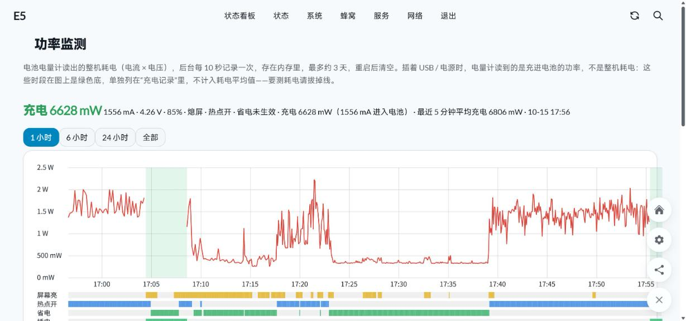

# 功率监测 · Power Monitor

整机耗电曲线和充电记录，按状态统计，可导出

*Power draw and charging over time, by state, exportable*

容悦 E5（OpenWrt）信息屏应用。当前版本 **v1.2**，应用 ID `powermon`。

## 截图

LuCI：状态 → 功率监测。整机功率曲线，下方色条标出屏幕亮、热点开、省电、插电的时段，绿色底为插电时段。

按状态统计平均功率、电流和满电可用时长（不含插电时段）。

## 深度休眠

v1.2 起能统计深度休眠（热点省电 v2.4 的「深度休眠」：熄屏、热点关、射频关、未插电时挂起到内存）期间的耗电。挂起时没有进程在运行，采样会中断；以前这段时间只按休眠前一个清醒样本计 60 秒，熄屏待机的平均功率因此被严重高估，曲线上也是断档。

- 采样脚本自己测出挂起时长：`sleep` 按 CLOCK_MONOTONIC 计时（挂起时停走），`/proc/uptime` 按 CLOCK_BOOTTIME 计时（挂起时照走），两者之差就是挂起的秒数，记在醒来后第一个样本的 `sleep` 列。不依赖热点省电，也不受系统时间校准影响，每次采样不多起进程。
- 耗电用电量计 `sc27xx-fgu/capacity`（0.1% 一档）在休眠前后的差估算：它来自 PMIC 的库仑计，挂起时照常计数。差值 × 电池容量（`charge_full`，3082 mAh）得到电量，再乘前后电压的平均值得到能量。
- 一档约 3 mAh，短休眠单独算误差很大：单次 30 分钟以上的休眠给出自己的数值，其余按所选范围内全部休眠累计计算（累计不到 10 分钟时显示「待测」）。
- 图上休眠段为紫色底，紫线是估算的功率（虚线表示用的是累计平均）；「各状态平均功率」里多一行「深度休眠」，时长是实际挂起时长，「全部（不含插电）」也计入了休眠段。

CSV 增加两列 `fgu`（电量计电量，0.1%）和 `sleep`（距上个样本挂起的秒数，清醒时为 0）。v1.1 的旧行只有 9 列，照常读取，其中的空档仍按断档处理。

## 安装

1. 下载 [`releases/powermon-v1.2.tar.gz`](releases/powermon-v1.2.tar.gz)。
2. 在信息屏的「应用管理」中安装（LuCI：服务 → 信息屏应用 → 应用管理）。
3. 安装后文件位于设备上的 `/etc/e5-infoscreen/plugins/powermon/`。

## 设置

加粗为默认值。

- 采样间隔（Sample interval）：5 秒；**10 秒**；30 秒；1 分钟

## 源码

`powermon/` 是当前版本安装包解压后的内容：

- [`backend.uc`](powermon/backend.uc)
- [`index.html`](powermon/index.html)
- [`luci/acl.json`](powermon/luci/acl.json)
- [`luci/index.js`](powermon/luci/index.js)
- [`luci/menu.json`](powermon/luci/menu.json)
- [`manifest.json`](powermon/manifest.json)
- [`powermon.init`](powermon/powermon.init)
- [`service.sh`](powermon/service.sh)

## 版本

- [v1.2](releases/powermon-v1.2.tar.gz)（当前）：统计深度休眠期间的耗电；信息屏页面增加最近 24 小时电量图；修正「预计充满」恒为 0 分钟
- [v1.1](releases/powermon-v1.1.tar.gz)
- [v1.0](releases/powermon-v1.0.tar.gz)
